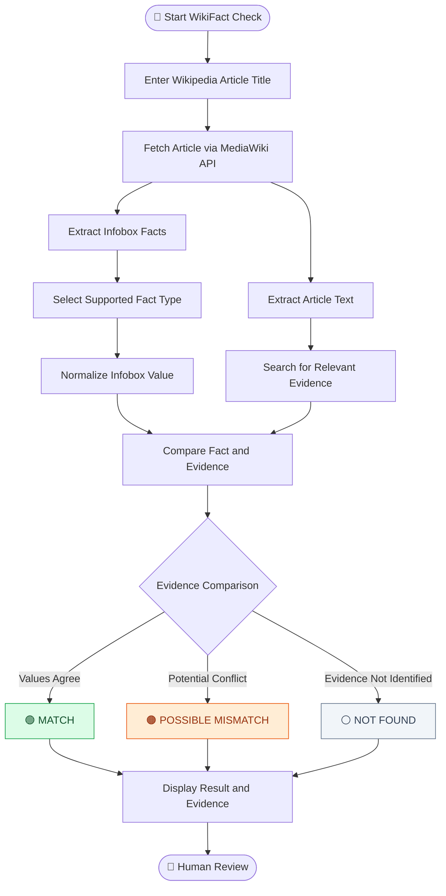
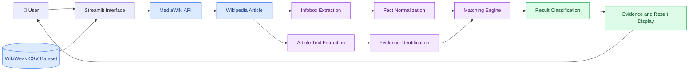
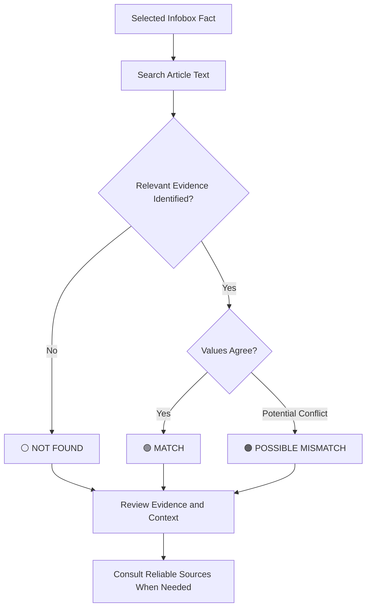
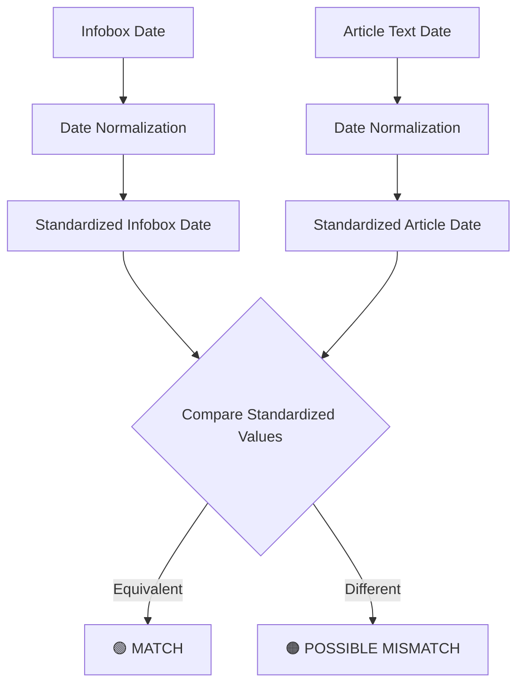
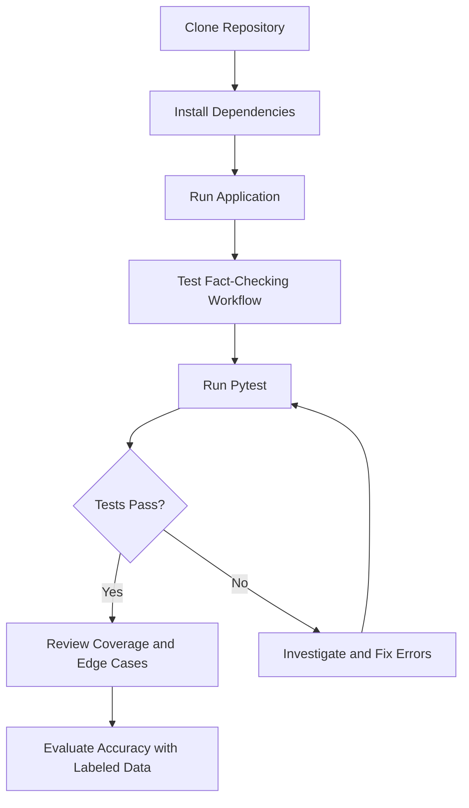
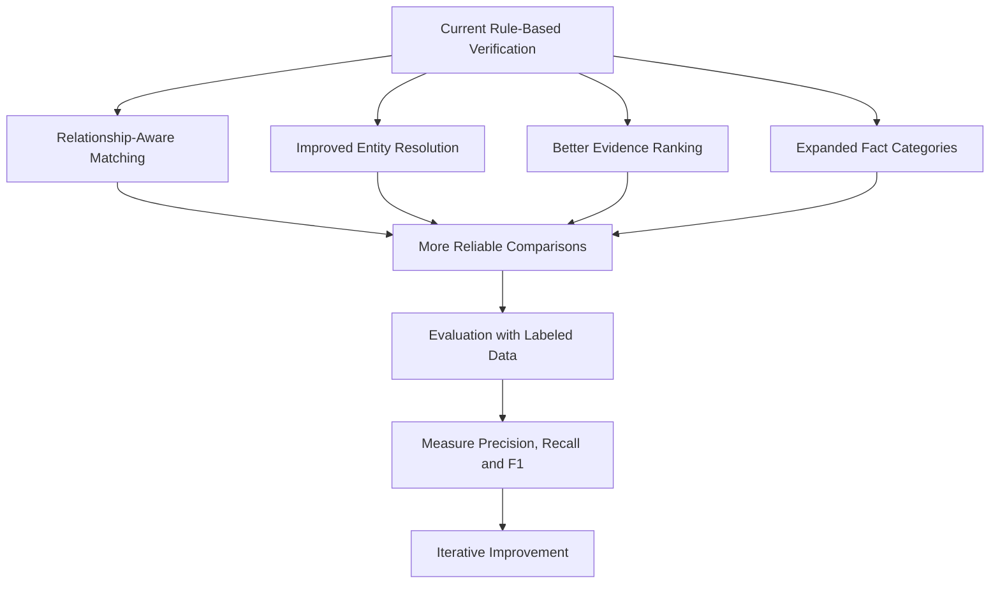
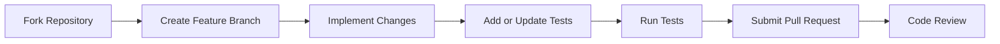

# 🔎 WikiFact Check

### Evidence-Based Verification of Wikipedia Infobox Facts

<p align="center">
  <strong>Investigate → Compare → Identify Evidence → Review</strong>
</p>

<p align="center">
  <a href="https://github.com/Saksham-M4/WikiFact-Check">
    
  </a>
  <a href="https://wikifact-check-mfi8axlwerctayxu2yjyct.streamlit.app/">
    
  </a>
  
  
</p>

**WikiFact Check** is an experimental fact-verification application that compares structured facts in Wikipedia infoboxes with information found in the corresponding article text.

It identifies potential inconsistencies, presents relevant evidence, and helps users review structured information more transparently.

Built for **Wikimedia Open Source Day — Challenge 4**.

<p align="center">
  <a href="https://wikifact-check-mfi8axlwerctayxu2yjyct.streamlit.app/"><strong>🚀 Try the Live Demo</strong></a>
  &nbsp; • &nbsp;
  <a href="https://github.com/Saksham-M4/WikiFact-Check"><strong>💻 Explore the Source Code</strong></a>
</p>

---

## 📌 Table of Contents

- [Overview](#-overview)
- [Why WikiFact Check](#-why-wikifact-check)
- [Key Features](#-key-features)
- [System Workflow](#-system-workflow)
- [System Architecture](#-system-architecture)
- [Result Classification](#-result-classification)
- [Supported Fact Types](#-supported-fact-types)
- [Date Normalization](#-date-normalization)
- [Technology Stack](#-technology-stack)
- [Getting Started](#-getting-started)
- [Running Tests](#-running-tests)
- [Project Structure](#-project-structure)
- [Dataset and Data Sources](#-dataset-and-data-sources)
- [Limitations](#-limitations)
- [Future Improvements](#-future-improvements)
- [Contributing](#-contributing)
- [Disclaimer](#-disclaimer)
- [Author](#-author)

---

## 📖 Overview

Wikipedia articles contain structured information in infoboxes, including birth dates, founders, locations, and countries.

However, a structured fact may not always be explicitly supported by the text of its corresponding article.

WikiFact Check helps investigate these situations by comparing selected infobox facts with relevant information in the article text.

### 🎯 The Core Idea

**Wikipedia Infobox → Article Text → Evidence Matching → Result → Human Review**

The application classifies the comparison into three possible outcomes:

- 🟢 **MATCH** — The values agree according to the implemented matching logic.
- 🟠 **POSSIBLE MISMATCH** — A potential inconsistency has been identified.
- ⚪ **NOT FOUND** — Corresponding evidence could not be identified.

The goal is to make structured Wikipedia information easier to inspect, compare, and review.

---

## 💡 Why WikiFact Check?

- 🔍 **Transparency:** Shows relevant article evidence for human inspection.
- ⚖️ **Consistency checking:** Identifies potential differences between structured facts and article text.
- 📄 **Evidence-based review:** Helps users understand the information behind a result.
- 🌐 **Live retrieval:** Retrieves article content through the MediaWiki API.
- 🧠 **Human-in-the-loop verification:** Supports investigation rather than claiming to establish absolute truth.
- 🧪 **Testability:** Includes automated tests for the implemented matching logic.

---

## ✨ Key Features

| Feature | Description |
|---|---|
| Live Wikipedia Retrieval | Retrieves article content through the MediaWiki API |
| Infobox Fact Extraction | Extracts supported structured facts from Wikipedia articles |
| Fact Normalization | Handles recognized variations in dates and names |
| Evidence Identification | Finds relevant article sentences for review |
| Potential Mismatch Detection | Flags possible inconsistencies |
| Multiple Fact Categories | Supports birth dates, founders, locations, and countries |
| WikiWeak Dataset Integration | Helps users discover article titles through a CSV dataset |
| Article Image Display | Displays an associated article image when available |
| Interactive Interface | Provides a user-friendly Streamlit workflow |
| Automated Testing | Tests the implemented fact-checking logic |

---

## 🔄 System Workflow

The following diagram illustrates the complete fact-checking workflow.



### Workflow Explained

1. **Input →** The user enters an article title.
2. **Retrieval →** The application fetches the article from Wikipedia.
3. **Extraction →** The system identifies available infobox facts and article text.
4. **Selection →** The user selects a supported fact category.
5. **Normalization →** Recognized value variations are standardized.
6. **Evidence search →** The system looks for relevant information in the article.
7. **Comparison →** The implemented matching rules compare the values.
8. **Classification →** The application produces a result.
9. **Review →** The user examines the evidence and decides whether further verification is needed.

---

## 🏗️ System Architecture

This diagram shows how the main components interact.



### Architecture Components

| Component | Responsibility |
|---|---|
| Streamlit Interface | Accepts input and displays results |
| MediaWiki API | Retrieves Wikipedia article information |
| Infobox Extraction | Identifies supported structured facts |
| Article Text Extraction | Obtains text for evidence searching |
| Fact Normalization | Standardizes recognized dates and names |
| Evidence Identification | Searches for relevant article sentences |
| Matching Engine | Compares extracted values with identified evidence |
| Result Classification | Produces MATCH, POSSIBLE MISMATCH, or NOT FOUND |
| WikiWeak Dataset | Assists with article-title discovery |

---

## 🚦 Result Classification



| Result | Meaning |
|---|---|
| 🟢 MATCH | The infobox value and identified article evidence agree according to the implemented rules. |
| 🟠 POSSIBLE MISMATCH | The comparison identifies a potential inconsistency that needs human review. |
| ⚪ NOT FOUND | The current implementation could not identify corresponding evidence. |

### Example

Suppose an infobox lists a birth year as `1980`, while the relevant article text mentions `1981`.

If the matching rules identify the conflicting values, the system may report **POSSIBLE MISMATCH**.

This does not prove which year is correct. The user must inspect the evidence and consult reliable sources when necessary.

---

## 🧩 Supported Fact Types

| Fact Type | Example | Verification Approach |
|---|---|---|
| Birth Date | Narendra Modi — 17 September 1950 | Normalizes recognized date representations before comparison |
| Founder | Google — Larry Page and Sergey Brin | Searches for normalized names and relevant textual evidence |
| Location | An organization or place | Compares structured location values with relevant article text |
| Country | An entity associated with a country | Searches for corresponding country information in the article |

The results depend on the article structure, available evidence, and matching rules implemented for each fact type.

---

## 📅 Date Normalization

Equivalent dates can appear in different formats.

For example:

```text
1950-09-17
      ↓
17 September 1950
      ↓
September 17, 1950
      ↓
17/09/1950
```

When these formats are recognized by the implementation, they can be normalized before comparison.



Normalization helps distinguish formatting differences from potential factual disagreements.

---

## 🛠️ Technology Stack

| Technology | Purpose |
|---|---|
| Python | Core application logic and data processing |
| Streamlit | Interactive web interface |
| MediaWiki API | Wikipedia article retrieval |
| Pandas / CSV | Dataset handling, where used |
| Pytest | Automated testing |
| WikiWeak Dataset | Article-title discovery |

---

## 🚀 Getting Started

Follow these steps to run WikiFact Check locally.

### Prerequisites

- Python 3
- Git
- Internet access for retrieving Wikipedia content

### Step 1: Clone the Repository

```bash
git clone https://github.com/Saksham-M4/WikiFact-Check.git
```

### Step 2: Navigate to the Project

```bash
cd WikiFact-Check
```

### Step 3: Create a Virtual Environment (Recommended)

**macOS / Linux**

```bash
python3 -m venv .venv
source .venv/bin/activate
```

**Windows**

```bash
python -m venv .venv
.venv\Scripts\activate
```

### Step 4: Install Dependencies

```bash
python -m pip install -r requirements.txt
```

### Step 5: Launch the Application

```bash
streamlit run app.py
```

> **Important:** Run the application using `streamlit run app.py`, not `python app.py`.

### Step 6: Open the Application

Streamlit normally provides the following local address:

```text
http://localhost:8501
```

Open the URL in your browser.

### 🌐 Try the Live Demo

You can also access the deployed application:

**[🚀 Open WikiFact Check](https://wikifact-check-mfi8axlwerctayxu2yjyct.streamlit.app/)**

The live application requires network access and may be affected by deployment availability or changes to Wikipedia content.

---

## 🧪 Running Tests

Run the existing deterministic test suite from the project directory:

```bash
python -m pytest test_factcheck.py
```

Pytest reports which tests pass and which fail.

### Suggested Test Scenarios

| Scenario | Expected Behavior |
|---|---|
| Equivalent date formats | Recognized equivalent dates should match |
| Conflicting date values | A recognized conflict may be flagged |
| Matching founder information | Names and relationships should match when supported by the implemented rules |
| Missing evidence | The result may be NOT FOUND |
| Alternative name formats | Recognized variations should be handled appropriately |
| Unusual article structures | Unsupported or missing fields should be handled safely |

These are suggested scenarios, not a claim that every case is already covered by the existing tests.

### Testing Workflow



A passing test suite checks the cases covered by those tests; it does not independently establish overall verification accuracy.

---

## 📁 Project Structure

The following structure reflects the main files visible in the repository listing.

```text
WikiFact-Check/
│
├── app.py
│   └── Main Streamlit application
│
├── test_factcheck.py
│   └── Automated tests
│
├── requirements.txt
│   └── Python dependencies
│
├── DATASET_NOTE.txt
│   └── Dataset documentation
│
├── IMAGE_FEATURE.md
│   └── Article image feature documentation
│
├── TEACHER_DEMO_CHECKLIST.md
│   └── Demonstration preparation checklist
│
└── README.md
    └── Project documentation
```

If additional modules or dataset files are added, update this diagram to match the actual repository.

---

## 📚 Dataset and Data Sources

### WikiWeak Dataset

The WikiWeak dataset assists users in discovering and selecting article titles through a CSV file.

Depending on the dataset structure, recognized title-column names may include:

- `name`
- `title`
- `article_title`
- `article_name`
- `article name`

The dataset supports article discovery; the application retrieves Wikipedia content for its fact-checking workflow.

**Important:** The dataset should not be treated as independent evidence that a claim is true.

### Wikipedia MediaWiki API

The MediaWiki API provides access to Wikipedia article content used by the application.

Because Wikipedia content can change, results may differ between runs.

---

## ⚠️ Limitations

WikiFact Check is an experimental system based on implemented extraction, normalization, and matching rules.

- **Relationship ambiguity:** Mentioning two people in one sentence does not prove they founded an organization together.
- **Infobox variability:** Unusual templates or page structures may prevent successful extraction.
- **Evidence relevance:** A sentence may mention a related topic without directly supporting a claim.
- **Normalization constraints:** Unrecognized dates, aliases, abbreviations, and name variations may not be handled correctly.
- **Context limitations:** Text-based matching may overlook negation, qualifiers, historical changes, or differences in meaning.
- **Live content changes:** Wikipedia edits can affect results between runs.
- **API dependency:** Retrieval requires network access and Wikimedia API availability.
- **Evaluation limitations:** Overall verification accuracy has not been established through a reported quantitative evaluation.

These limitations mean that human review remains essential.

---

## 🛣️ Future Improvements

Potential future enhancements include:



Planned improvements:

- **Relationship-Aware Verification:** Better identification of explicit relationships such as "founded by" and "co-founded by."
- **Quantitative Evaluation:** Measure precision, recall, and F1-score using manually labeled examples.
- **Expanded Fact Coverage:** Support additional infobox fields.
- **Entity Resolution:** Improve handling of aliases and alternative names.
- **Confidence Scoring:** Introduce calibrated confidence estimates if supported by evaluation.
- **Improved Evidence Extraction:** Rank multiple evidence sentences and distinguish direct support from simple mentions.
- **Context-Aware Matching:** Account for negation and temporal information.
- **Multilingual Support:** Extend verification to additional language editions of Wikipedia.
- **Regression Testing:** Cover unusual article structures, conflicting values, and missing fields.

---

## 🤝 Contributing

Contributions, suggestions, and bug reports are welcome.

### Contribution Workflow



To contribute:

1. Fork the repository.
2. Create a feature branch.
3. Implement your changes.
4. Add or update relevant tests.
5. Run the existing test suite.
6. Submit a pull request describing your changes.

For significant changes, consider opening an issue before implementation.

---

## ⚖️ Disclaimer

WikiFact Check is an educational and experimental project designed to assist with reviewing structured Wikipedia information.

- **MATCH** means the implemented logic identified agreement between the infobox value and article text. It does not independently establish factual truth.
- **POSSIBLE MISMATCH** indicates a potential inconsistency requiring human review.
- **NOT FOUND** means the implementation did not identify corresponding evidence. It does not prove that supporting information does not exist.

Results depend on article content, extraction, normalization, and matching logic.

Users should inspect the displayed evidence and consult authoritative sources before drawing conclusions.

**WikiFact Check supports fact investigation; it does not replace human judgment or authoritative verification.**

---

## 👨‍💻 Author

**Saksham Kumar**

Student at Garden City University, Bengaluru, India.

Developed for **Wikimedia Open Source Day — Challenge 4**.

- **GitHub:** [Saksham-M4](https://github.com/Saksham-M4)
- **Repository:** [WikiFact-Check](https://github.com/Saksham-M4/WikiFact-Check)
- **Live Application:** [WikiFact Check](https://wikifact-check-mfi8axlwerctayxu2yjyct.streamlit.app/)

---

<p align="center">
  <strong>WikiFact Check</strong>
  <br>
  <em>Making structured knowledge easier to inspect, compare, and verify.</em>
  <br><br>
  Built with Python, Streamlit, and a commitment to transparent fact checking.
</p>
